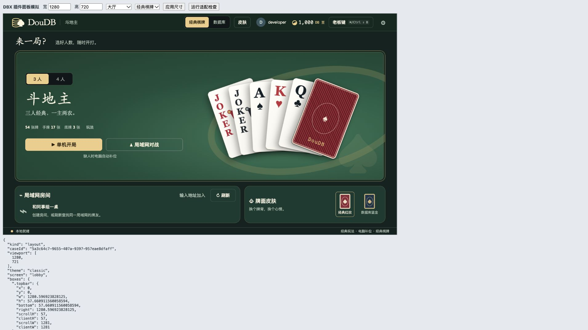
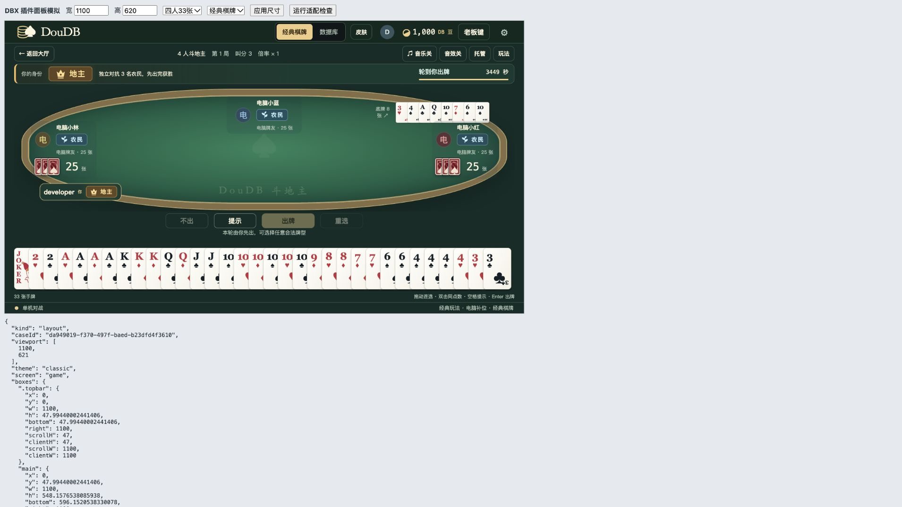

# DouDB

DBX 的独立斗地主插件，支持单机电脑对战和局域网组局。

[下载候选安装包](https://github.com/yuwenGueen/dbx-doudb/releases) · [报告问题](https://github.com/yuwenGueen/dbx-doudb/issues) · [数据与网络说明](docs/security.md)

首个商店候选版本仅提供 **macOS Apple Silicon（darwin-arm64）**。界面语言为简体中文，商店简介提供中英文。DB 豆仅为本地游戏积分，没有充值、兑换或真钱交易。

## 已实现

- 三人经典斗地主与四人双副牌斗地主，分别处理发牌、牌型与结算。
- 单机电脑对战、提示、选牌、出牌、不出、托管和局后结算。
- 局域网建房、UDP 房间发现、手动地址加入、房主开始与电脑补位。
- 经典棋牌与数据库主题，独立主题与牌面资源，通过清单动态加载，可继续增加皮肤。
- 明确的地主皇冠、农民麦穗和个人阵营说明；支持拖动选牌、双击同点数和实时牌型反馈。
- 真实牌局事件驱动的发牌、地主登场、出牌、炸弹、王炸、飞机、春天和结算特效；爆破、升空及胜利分层音效。
- 原创《午后牌局》钢琴 / 贝斯循环背景音乐，音乐与音效独立开关；音乐音量可调，默认关闭，老板键和后台自动静音。
- 出牌按玩家座位显示，当前待压牌有明确标记；大小王采用竖排 JOKER 与小丑图案，红色大王、黑色小王，选牌不盖住相邻牌。
- 切换界面保留牌局和已选手牌，每位玩家的风格独立保存。
- DB 豆积分、昵称和界面偏好持久化、重复操作及重复结算保护。
- 老板键：按钮或 Ctrl/Cmd + Shift + B；Esc 恢复。展示的是模拟表格。

## 本地开发

需要 Node.js 22+ 和 Go 1.22+。没有前端 npm 依赖；后端只使用 Go 标准库与随项目保存的 DBX Go SDK。

```sh
npm run dev
```

打开终端打印的 `http://127.0.0.1:5190`。端口可用 `DOUDB_PORT` 修改。
预览仅监听本机；点“创建房间”后，牌局服务才会监听局域网端口。
开发资料保存在 `.dbx-dev/preview`，均已加入忽略规则。

```sh
npm test           # Go race 检查与规则/网络/存储测试
npm run build      # 生成 bin/doudb 或 bin/doudb.exe
npm run smoke      # 构建后运行两个独立实例的集成验证
```

## DBX 插件

插件 ID 为 `dev.doudb.suite`，版本 `0.1.4`。通过工作台贡献点打开，不需要数据库连接或数据库查询权限。

```sh
npx @dbx-app/plugin-cli@0.1.9 package . --target darwin-arm64
```

安装包和 artifact metadata 写入 `dist/`。开发包未签名，需要在 DBX 插件中心开启“允许安装未签名开发包”后本地安装。未发布到商店。

原生插件运行时由 DBX 启动 Go Sidecar，使用官方 SDK 的 JSONL RPC。开发预览与真实插件复用同一套后端业务代码；预览入口提供的 HTTP API 仅监听 127.0.0.1。

## 皮肤与特效

顶部“皮肤”面板可以切换界面主题和单独搭配牌面；“设置 → 预览游戏特效”可查看动效而不改变牌局。牌局中可分别开启音乐和音效，设置里可调整音乐音量。音乐和音效均在本地合成，不依赖外网音频。

新增皮肤只需添加皮肤模块／素材并登记 `ui/skins/catalog.js`。详细字段、示例与目录说明见 [皮肤维护指南](docs/skins.md)。

## 固定玩法

| 项目 | 三人 | 四人 |
| --- | --- | --- |
| 牌数 | 一副 54 张 | 两副 108 张 |
| 初始手牌 | 每人 17 张 | 每人 25 张 |
| 底牌 | 3 张 | 8 张 |
| 地主手牌 | 20 张 | 33 张 |
| 阵营 | 地主对两名农民 | 地主对三名农民 |
| 王炸 | 一大王 + 一小王 | 两大王 + 两小王 |
| 普通炸弹 | 4 张同点数 | 4–8 张同点数，张数优先 |
| 三带一、飞机带单 | 支持 | 不支持 |
| 三带二、飞机带对 | 支持 | 支持 |
| 四带二、四带两对 | 支持 | 不支持 |

两种玩法的顺子、连对与飞机主体均不包含 2 和王。叫分使用不叫 / 1 / 2 / 3 分，叫分需递增，3 分立即成为地主。全部不叫时重新发牌，连续三次无人叫分后指定首叫玩家以 1 分成为地主。底牌在确定地主后公开。

底分 10 豆，乘以叫分；每个炸弹或王炸翻倍，春天再翻倍。地主胜负为每名农民输赢的总和，同桌结算合计为零。

参考：[三人发牌与叫牌](https://gameabc.com/news/201910/6043.html)、[四人发牌](https://www.pook.com/mobile/srddz/rule/rule-1.html)、[四人炸弹与王炸](https://mm.pook.com/srddz/rule/rule-3.html)。地区玩法存在差别；以上表格定义本插件当前采用的固定版本。

## 局域网与积分边界

- 房主维护牌局权威状态，只给每位玩家发送本人的手牌、其他玩家张数和公开出牌。
- 电脑仅使用自身手牌、当前出牌和公开阵营信息决策，属于基础规则策略。
- 新玩家在等待或结算阶段入座；进行中的断线玩家由电脑托管，同一连接凭据可重连恢复座位。
- 房主退出会关闭房间，当前版本不做房主迁移。
- 顶部与自己座位统一显示本机 DB 豆余额，结算单独显示本局增减。房间内部计分不再作为个人余额展示。本机只记录收到的已结束牌局结算，中途离开后的离线局后积分不做跨房间补发。
- 当前为积分记账模式，余额可能为负；最低为零、免费补给和按实际余额封顶赔付的规则尚未实现。
- 实际跨电脑发现与连接取决于同网段可达及系统防火墙；可用房主展示的 IP:端口手动加入。

## 验证

已运行 Go race 检查、三人与四人各 80 局电脑对战、牌型差异与非法动作、幂等结算及重启读取测试；已通过本机两个独立进程的局域网发现、建房入房、手牌隔离和共享底牌验证。

新增测试覆盖选牌反馈复用规则、不修改牌局状态、公开特效事件顺序与范围、新皮肤 ID 和音效偏好持久化；背景音乐开关 / 音量独立保存、非法音量拒绝且不改变已有设置。

浏览器中实际验证了四人初始 25 张 / 地主 33 张、拖选 / 同点数选牌 / Enter 出牌、两种界面切换保留手牌和选牌、老板键恢复、底牌放大和 390px 窄窗口。临时第三套主题只新增模块和清单即可切换并在刷新后保留；同等 CSP 的不透明沙箱 iframe 内也通过了主题与牌面切换验证。跨电脑实机及 DBX 桌面宿主的最终安装联调仍需验证。

已用独立界面用例检查三人 / 四人各位置、30 张长牌型、390px 窗口、当前待压牌标记和新轮清牌；验证了选牌时相邻点数仍可点击、顶部和座位余额相同、大小王与 J 标记不同。实际浏览器音频采样确认音乐 / 音效有输出、无削波和老板键静音；独立真实牌局验证音乐设置保存以及自己出牌位于自己区域。

### 面板自适应（v0.1.4）

布局跟随 DBX 插件 iframe 的实际宽高：大厅以标题、主卡片、房间与皮肤三行分配剩余空间，矮窗口收紧字号和间距；游戏工具栏、手牌与出牌按钮保持可见，长牌型和窄窗口仅在牌桌/手牌区域滚动。刷新牌局时保留滚动位置。两套主题共用 `ui/viewport.css`，经典主题不再强制覆盖响应式字号。

在不透明 `sandbox="allow-scripts"` iframe 中验证了经典/数据库主题、大厅/三人/四人 33 张手牌/长牌型，覆盖 1700×880、1280×720、1100×620、960×540、800×650、600×720、390×720 共 56 个组合。常见桌面尺寸大厅完整显示，所有组合无页面横向溢出，出牌按钮和手牌未被底栏遮挡。窄窗口的大厅内容可纵向滚动；极矮牌桌与超长牌型保留独立滚动。更新包仍需在 DBX 实际窗口中复测。

## 运行截图

以下为不透明沙箱 iframe 中的独立测试场景；均使用模拟账号和牌局。





## 发布

发布使用版本标签与固定工具版本，安装包仅放在 GitHub Releases，不提交到 Git 历史。

1. 同步更新 `manifest.json`、`package.json`、`backend/main.go` 中的版本号，并新增 `docs/releases/v<版本>.md`。
2. 运行 `npm test`、`npm run build`、`npm run smoke`，验证 DBX 桌面宿主与两套皮肤。
3. 提交源码后推送 `v<版本>` 标签。GitHub Actions 在原生 macOS ARM64 runner 上复测、打包并创建 Release，上传 `.dbxp`、`.artifact.json` 和 `release-candidates.json`。
4. 按 [DBX Store 贡献指南](https://github.com/t8y2/dbx-store/blob/main/CONTRIBUTING.md) 提交候选 metadata。正式上架仍需维护者审核、签名和合并。

已发布版本与资产不可覆盖；修改安装包内容时必须使用新的版本号。首次商店申请的权限、网络行为和已知限制见 [发布审核说明](docs/security.md)。

## 目录

- `ui/`：不依赖外部 CDN 的静态界面。
- `backend/`：规则、电脑策略、房间、持久化和插件 RPC。
- `backend/sdk/`：未修改的官方 DBX Go SDK，附上游许可与来源。
- `scripts/`：开发、构建和双实例验证脚本。
- `assets/`：打包图标与许可文件。
- `designs/`：当前运行截图；早期设计迭代保留在本地。
- `manifest.json` / `dbx-plugin.toml`：插件入口及打包契约。

源码与发布在本仓库独立维护。
